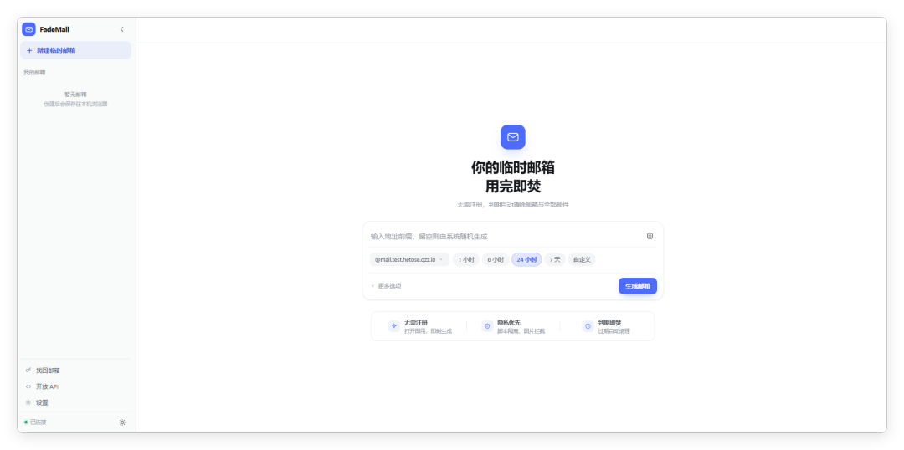

# 🚀 FadeMail — 会自己过期的临时邮箱

> 一个部署在 **Cloudflare Workers + D1 + Email Routing** 上的临时邮箱系统。
> Worker 干活、D1 存信、Email Routing 收信，全程白嫖免费额度——
> 跟着下面教程走，一杯奶茶的时间，你也有自己的邮箱网站。☕

**一句话简介**：不用买服务器、不用注册账号，输入前缀点一下，邮箱到手，到期自动焚毁。



---

## ⚠️ 先看这里：风险声明（必读）

部署之前把这段看完，别跳：

1. **有被 Cloudflare 封号的风险。** 用 Workers / D1 / Email Routing 承载临时邮箱，
   可能踩到 Cloudflare 服务条款里关于邮件服务和资源滥用的红线，这类项目被限制、
   封号的先例不少。**别在公司官网、主力域名那种重要账号上部署**，拿个独立小号 +
   独立便宜域名练手，翻车了也不心疼。
2. **本项目仅供学习和技术交流。** 请勿拿临时邮箱去批量注册、绕实名、搞欺诈骚扰——
   违法违规的事情不要做，做了后果自己扛，项目作者不背这个锅。
3. **临时邮箱天生是「弱隐私」。** 地址 + 访问密钥泄露 = 邮件被看光；到期即焚 = 永远找不回。
   密码重置邮件、账单这种正经邮件，请交给正经邮箱。
4. 本项目按「现状」提供，因使用本项目导致的账号、数据、法律或其他任何损失，作者概不负责。

---

## ✨ 它能做什么

- 🎯 **隐私友好** — 不用注册，用完即焚，别把真实邮箱到处乱塞了
- ⏰ **自定义有效期** — 1 小时 / 6 小时 / 24 小时 / 7 天，也能自定义，最长 30 天
- ⚡ **实时收信** — 每 6 秒轮询，新邮件自己蹦出来，不用狂按 F5
- 🔔 **桌面通知** — 授权之后新邮件弹系统通知，标题还带未读数
- 📝 **邮箱备注** — 给每个邮箱写备注，忘掉「这是注册啥用的」这种抓狂时刻
- ➕ **加号别名** — `demo+任意标签@域名` 自动投递到 `demo@域名`，一个邮箱变无数个马甲
- 🔐 **密码找回** — 创建时设个找回密码（全局唯一），换设备也能把邮箱领回来
- 🌐 **多域名支持** — `domains` 表统一管理，一个系统挂 N 个后缀随便切
- 🛡️ **查看加固** — 正文服务端净化 + CSP 沙箱 + 图片默认拦截 + 附件强制下载
- 🧑‍💼 **管理后台** — `/admin` 数据总览、邮箱 / 域名 / API Key 管理、活动日志一站搞定
- 🔌 **开放 API** — RESTful 接口 + API Key 鉴权，想怎么玩就怎么玩
- ⌨️ **键盘快捷键** — `/` 搜索、`R` 刷新、`C` 复制地址、`Esc` 返回
- 🚫 **只收不发** — 没有发信能力，想拿它发垃圾邮件的人可以散了

## 🎯 出发前准备

| 材料 | 说明 | 必需？ |
|------|------|--------|
| Cloudflare 账号 | 免费注册一个 | ✅ |
| 一个域名 | 托管在 Cloudflare（收信 + 站点入口全靠它） | ✅ |
| D1 数据库 | 面板点几下创建，复制 Database ID | ✅ |
| Node.js | 本地 >= 20 | ⚠️ 只有方式二需要 |
| 一双手 + 一杯奶茶 | 跟着教程一步步来 | ✅ |

> 💡 新手直接冲「方式一」，不用装任何本地环境，点点鼠标就完事。

---

## 🚀 部署教程

### 方式一：GitHub Actions 自动部署（推荐新手）

**第一步：Fork 项目**

点右上角 **Fork**，把仓库搬回自己账号下。

**第二步：建 D1 数据库**

Cloudflare 面板 → **Storage & Databases → D1 SQL Database → Create**，
名字随意（比如 `fademail`），建好复制 **Database ID**。

**第三步：创建 API Token**

头像 → **My Profile → API Tokens → Create Token**，选 **Edit Cloudflare Workers**
模板打底，再补三个权限：`Zone → DNS → Edit`、`Zone → Email Routing → Edit`、
`Zone → Zone → Read`。建好立刻复制，**Token 只显示一次**。

**第四步：配置 Secrets**（Fork 的仓库 → Settings → Secrets and variables → Actions）

| Secret 名称 | 填什么 | 示例 |
|------------|--------|------|
| `CF_API_TOKEN` | 第三步的 Token | `xxxx` |
| `CF_ACCOUNT_ID` | 面板首页右侧 | `xxxx` |
| `SITE_DOMAIN` | 站点域名（完整主机名） | `mail.example.com` |
| `ZONE_NAME` | 域名所在的 zone | `example.com` |
| `MAIL_DOMAINS` | 收信域名，逗号分隔 | `mail.example.com,fademail.example.com` |
| `D1_DATABASE_ID` | 第二步的 ID | `xxxx` |
| `SITE_PASSWORD` | 全站门禁密码 | 自己定一个，别用 123456 🙃 |

选填：`WORKER_NAME`、`D1_DATABASE_NAME`（默认都叫 `fademail`）、`BRAND`、
`DEFAULT_TTL_HOURS` / `MAX_TTL_HOURS`（默认 24 / 720）。

**第五步：点火**

仓库顶部 **Actions → Deploy to Cloudflare → Run workflow → Run**。
等几分钟，**绿灯亮起的那一刻，你就是有邮箱网站的人了**（建表在流水线里自动完成）。
Secrets 没配齐时流水线会自动跳过，不会红给你看。

**第六步：让域名开始收信（不做这步永远收不到邮件！）**

往下翻到 [📬 配置收信](#-配置收信email-routing)，两种部署方式都逃不开这步。

### 方式二：本地手动部署（适合想折腾的）

```bash
# 1. 克隆
git clone https://github.com/QeeoDev/fademail.git
cd fademail

# 2. 装依赖
npm install

# 3. 改配置：打开 wrangler.jsonc，把标了「改成你的」的地方全换成自己的
#    （routes 站点域名与 zone、D1 数据库 ID、vars 里的域名们）

# 4. 本地环境变量（门禁密码，本地默认 123456）
cp .dev.vars.example .dev.vars

# 5. 登录 Cloudflare
npx wrangler login

# 6. 远程建表（只需一次；schema 全是 IF NOT EXISTS，手滑多跑也无害）
npm run db:init:remote

# 7. 配 Secret
npx wrangler secret put SITE_PASSWORD     # 全站门禁密码，不配则整站 503 装死
npx wrangler secret put RECOVERY_SECRET   # 选填：不配则首次使用自动生成

# 8. 起飞
npm run deploy
```

> 💡 **不想把真实域名交给自己 fork 的仓库？** 复制一份 `wrangler.jsonc` 为
> `wrangler.local.jsonc`（在 `.gitignore` 里），真实值写在里面，
> `deploy` / `db:init:remote` / `tail` 会自动优先用它，仓库里保持干净模板。

### 📬 配置收信（Email Routing）

邮件想进 Worker，全靠 Cloudflare Email Routing 转交，两种部署方式通用：

**手动版（面板点击）：**

1. 域名 → **Email → Email Routing** → 首次点 **Get started** 开通（自动加 MX）
2. **Routing rules → Catch-all address** → 动作选 **Send to a Worker** → 选中你的 Worker → Save
3. 收信域名是子域（如 `mail.example.com`）的话，还得给子域配上和主域一样的
   MX + SPF——手动抄一遍也行，脚本党看下面

**脚本党一键版：**

```bash
# 权限：Zone → Email Routing → Edit、Email Routing Rules → Edit、Zone → DNS → Edit
CF_EMAIL_TOKEN=xxx CF_DNS_TOKEN=xxx ZONE_ID=yyy \
  node scripts/setup-email-routing.mjs fademail example.com mail,fademail
# 参数：[worker名] [zone名] [子域列表]；mail 会把主域 MX/SPF 复制到 mail.example.com
```

配完发封测试邮件到 `随便什么@你的收信域名`，前台能弹出，整条链路就通了 🎉

### 🧑‍💼 管理后台

只有 `https://你的站点域名/admin` 这一个入口，前台界面干干净净没有任何链接。

1. 首次打开自动创建管理员：**初始 `admin` / `123456`**，直接登录
2. 登录后第一件事：去「设置」**改账号改密码**（要验证当前密码），别偷懒
3. 同一页还能改站点名称、站点地址、有效期预设和首页提示，保存立即生效

密码 PBKDF2-SHA256 加盐存储；会话是 HttpOnly 签名 Cookie（12 小时）；
写操作都要带 `x-admin-csrf` 头。命令行党也可以配 `ADMIN_TOKEN` 走令牌调接口。

---

## ⚙️ 配置说明

**环境变量**（`wrangler.jsonc` 的 `vars`）：

| 变量名 | 说明 | 默认 |
|--------|------|------|
| `MAIL_DOMAINS` | 收信域名，逗号分隔，需已开启 Email Routing | 必填 |
| `SITE_URL` | 站点主地址：邮件内链接、CORS 白名单都以此为准 | 必填 |
| `ALLOWED_ORIGINS` | 接口 CORS 白名单，逗号分隔 | 必填 |
| `DEFAULT_TTL_HOURS` | 邮箱默认有效期（小时） | `24` |
| `MAX_TTL_HOURS` | 邮箱最长有效期（小时） | `720`（30 天） |
| `BRAND` | 站点名称 | `FadeMail` |

**Secrets**（`npx wrangler secret put <名称>`）：

| Secret | 必需？ | 说明 |
|--------|--------|------|
| `SITE_PASSWORD` | 推荐 | 全站门禁密码；**不配置时整站 503 锁死**——宁可装死也不裸奔。本地开发写在 `.dev.vars`，默认 `123456` |
| `RECOVERY_SECRET` | ⚪ | 找回密码的 HMAC 指纹密钥；不配则首次使用自动生成并写入 D1 |
| `ADMIN_TOKEN` | ⚪ | 命令行调管理接口的令牌；不配也能用后台账号密码 |

---

## 💻 本地开发调试

```bash
cp .dev.vars.example .dev.vars        # 门禁密码默认 123456，想改随你
npm run db:init                       # 本地 D1 建表
npm run dev                           # http://127.0.0.1:8787
```

本地收信不用等真实邮件：wrangler dev 自带本地投递端点，直接注入一封测试邮件：

```bash
npm run test:email -- demo@mail.example.com   # 换成你前台创建的邮箱
npm run smoke                                 # 接口 / 安全 / 后台冒烟测试
```

> `wrangler.jsonc` 里的占位域名本地直接能跑；想跟线上对齐，把 `MAIL_DOMAINS`
> 改成自己的就行。

---

## ❓ 常见问题

**Q: 部署完了收不到邮件？**
99% 是收信链路没配对，按顺序查：Email Routing 开了吗 → catch-all 指向 Worker 了吗
→ 子域 MX / SPF 补了吗 → `MAIL_DOMAINS` 里写了这个域名吗。

**Q: 打开网站一直「Service temporarily unavailable」？**
门禁没配置：`SITE_PASSWORD` 这个 Secret 不存在时全站锁死，是故意的安全设计。
配上立即恢复。

**Q: 大陆访问慢得想砸键盘？**
默认橙云可能把你绕到美西再回来。仓库自带优选脚本
`scripts/setup-preference.mjs`：站点域名改灰云 A 记录 + Worker Route 直连香港边缘，
先 `$env:DRY_RUN="1"` 看看计划再动手。没这需求就当无事发生。

**Q: 想加多个域名？**
`MAIL_DOMAINS` 逗号分隔随便加；每个域名都要开 Email Routing 并把 catch-all
指到 Worker，子域用脚本同步 MX/SPF 就行。

**Q: 密码忘了怎么办？**
邮箱没过期就用「找回密码」领回来；过期了就是焚了，找不回——这是特性，不是 bug。

**Q: 管理后台初始账号？**
`admin` / `123456`，首次打开 `/admin` 自动创建。**登进去第一件事改密码**，再说一遍。

---

## 🏗️ 架构与目录

```
发件人 ──MX──▶ Cloudflare Email Routing (catch-all)
                        │
                        ▼
              Worker email() ← postal-mime 解析
                        │
                        ▼
                 D1（mailboxes / messages / attachments）
                        ▲
   浏览器 ──HTTPS──▶ Worker fetch() ──▶ 静态资源 + /api/*
                        │
                        ▼
              Cron 每 23 分钟清理过期邮箱
```

```
src/index.js    入口：路由分发 / email / scheduled
src/gate.js     站点门禁：访问密码 + 签名 Cookie
src/api.js      REST API（前台 + /api/v1 + 管理端）
src/email.js    收信、MIME 解析、附件落库
src/lib.js      限流、PBKDF2、HMAC、过期清理
public/         前端（原生 JS 单页，无构建）
schema.sql      D1 表结构
scripts/        收信配置 / 优选加速 / 测试与冒烟脚本
```

---

## 🔌 API

**开放接口**（管理后台创建 Key，`Authorization: Bearer fm_xxx` 或 `X-API-Key`）：

```http
GET    /api/v1/domains
POST   /api/v1/mailboxes                 { local, domain, ttlHours, note, password }
GET    /api/v1/mailboxes/{address}
GET    /api/v1/mailboxes/{address}/messages?since=
GET    /api/v1/messages/{id}
DELETE /api/v1/mailboxes/{address}
```

**前台自用接口**（都要带邮箱的 40 位访问密钥：`X-Mailbox-Key` 头或 `?k=`）：

```http
GET    /api/config                       站点配置
POST   /api/mailboxes                    创建邮箱（返回 accessKey）
GET    /api/mailboxes/{id}/messages      收件列表（含 total / unread）
GET    /api/messages/{id}/html           沙箱渲染后的正文
GET    /api/attachments/{id}             附件下载
POST   /api/auth/login                   地址 + 密码登录
POST   /api/auth/recover                 找回密码取回邮箱
PATCH  /api/mailboxes/{id}               备注 / 延长有效期
DELETE /api/mailboxes/{id}               销毁邮箱
```

**管理接口**（登录会话 Cookie 或 `x-admin-token`，写操作带 `x-admin-csrf: 1`）：
`/api/admin/login|me|account|settings|overview|mailboxes|messages/{id}|events|domains|keys|purge`，
细节直接看 `src/api.js`，每个路由都有注释。

---

## 🔒 安全设计

收信是这类服务最敏感的一环，本项目做了五层隔离：

1. **访问密钥**：新建邮箱带 40 位随机 `accessKey`，读信、销毁都要带上；
   id 泄露不等于内容泄露，密钥只存在用户浏览器
2. **服务端净化**：`sanitizeEmailHtml()` 剥掉 `script / iframe / svg / form` 等危险标签、
   `on*` 事件、`javascript:` 伪协议，外链强制 `noopener noreferrer`
3. **CSP 沙箱**：正文在 `sandbox; default-src 'none'` 的 iframe 里渲染，
   有漏网脚本也跑不起来、出不去
4. **反追踪**：远程图片默认不加载，营销邮件的追踪像素摸不到你的 IP
5. **附件隔离**：只有位图能内联，SVG / HTML 一律强制下载还带独立 sandbox

外围也没偷懒：全站严格 CSP + HSTS、CORS 只回显显式白名单、限流只认
`cf-connecting-ip`（客户端可伪造的头一律不信）、找回密码指纹化存储且全局唯一
（防撞库互见邮箱）、管理会话 HttpOnly 签名 Cookie + CSRF 标记、
代码里零硬编码密钥。

---

## 📄 许可证

[MIT](LICENSE)。二开随意，顺手把默认密码改了。
